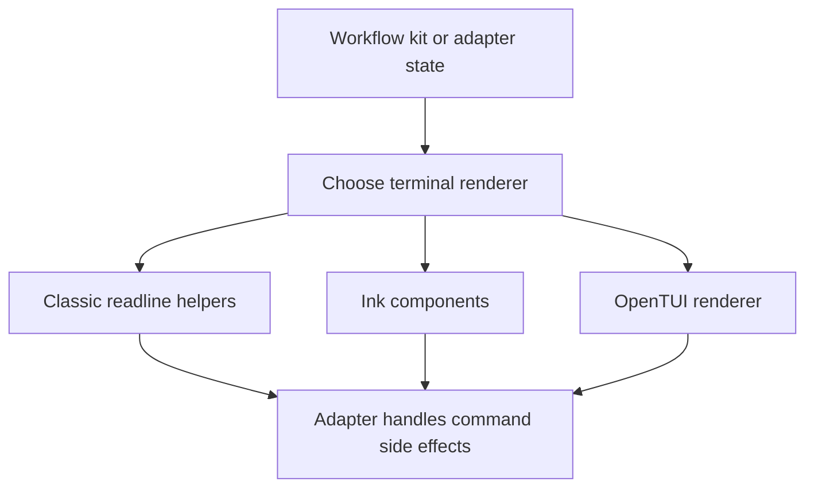

# @gg-utils/terminal-ui-kit

Reusable terminal UI primitives for classic readline, Ink, and OpenTUI command surfaces.

This package contains small framework helpers: classic menu session scaffolding, Ink status and
command-preview components, captured-output rendering, Chrome task bridge UI, stdout dimension
hooks, and OpenTUI renderer construction.

## Install

```bash
npm install @gg-utils/terminal-ui-kit@git+https://github.com/gg-utils/terminal-ui-kit.git#main
```

Pinned dependency example:

```json
{
  "dependencies": {
    "@gg-utils/terminal-ui-kit": "git+https://github.com/gg-utils/terminal-ui-kit.git#6e20420"
  }
}
```

## When To Use

- You need reusable terminal UI building blocks rather than a full workflow kit.
- You need classic interactive session scaffolding for numbered menus.
- You need Ink components for command preview, status, legend, captured output, or bridge tasks.
- You need an OpenTUI renderer factory shared across packages.

## Public Surfaces

| Import | Purpose |
|---|---|
| `@gg-utils/terminal-ui-kit/cli-interactive` | Classic readline framework helpers. |
| `@gg-utils/terminal-ui-kit/ink/status` | Ink status row rendering. |
| `@gg-utils/terminal-ui-kit/ink/command-preview` | Ink command-preview rendering. |
| `@gg-utils/terminal-ui-kit/ink/captured-output` | Captured stdout/stderr display. |
| `@gg-utils/terminal-ui-kit/ink/bridge-task` | Bridge task UI helpers. |
| `@gg-utils/terminal-ui-kit/ink/use-stdout-dimensions` | Terminal dimension hook. |
| `@gg-utils/terminal-ui-kit/opentui/create-renderer` | OpenTUI renderer factory. |

## Quick Start

```ts
import { CliInteractiveSession } from "@gg-utils/terminal-ui-kit/cli-interactive";

const session = new CliInteractiveSession({ brandLabel: "TOOLS" });

try {
  const action = await session.chooseFromList({
    items: [
      { label: "Status", value: "status" },
      { label: "Quit", value: "quit" },
    ],
    promptTitle: "Choose an action",
    promptSubtitle: "Use the number keys.",
  });
  console.log(action);
} finally {
  session.close();
}
```

## Operational Flow



## Development

```bash
git clone https://github.com/gg-utils/terminal-ui-kit.git
cd terminal-ui-kit
npm install
npm run type-check
npm run build
```

## Layout

```text
.
|-- src/cli-interactive/
|-- src/ink/
|-- src/opentui/
|-- dist/
`-- package.json
```

## Caveats

- This package is intentionally lower level than the domain kits.
- It does not own command catalogs, workflow state, or subprocess policy.
- Consumers should keep domain labels and risk decisions in their own packages.

## Use from another repository

Requires Node `>=22.0.0 <27`. Install the built JavaScript and declarations by tag:

```json
{"dependencies": {"@gg-utils/terminal-ui-kit": "git+https://github.com/gg-utils/terminal-ui-kit.git#v0.2.0"}}
```
